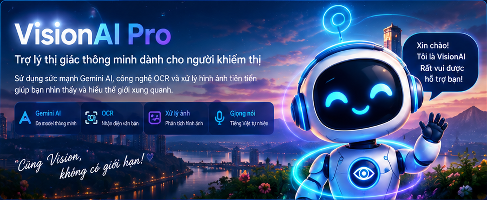
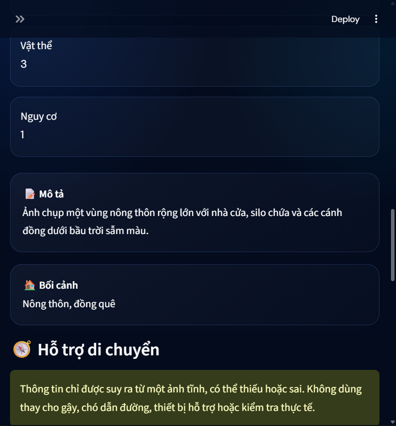
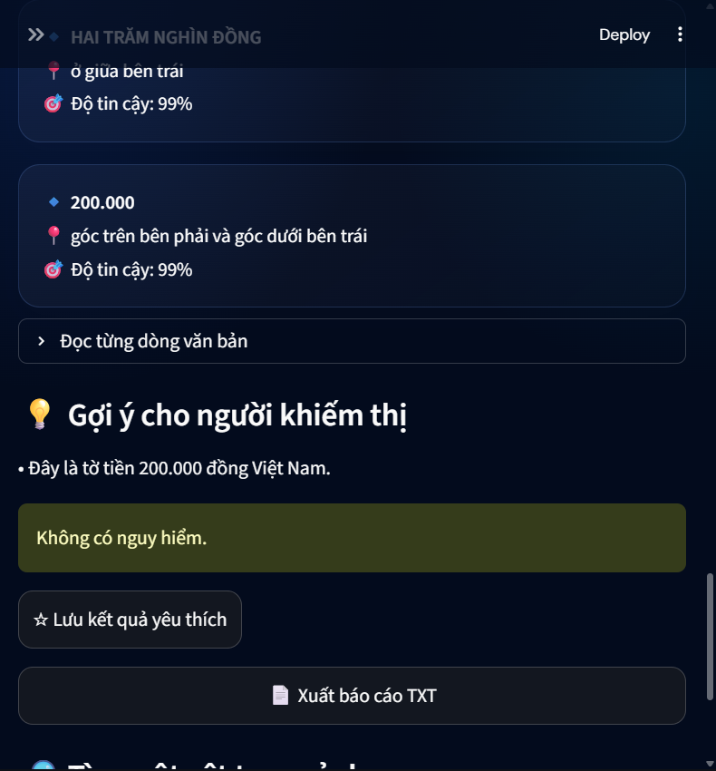
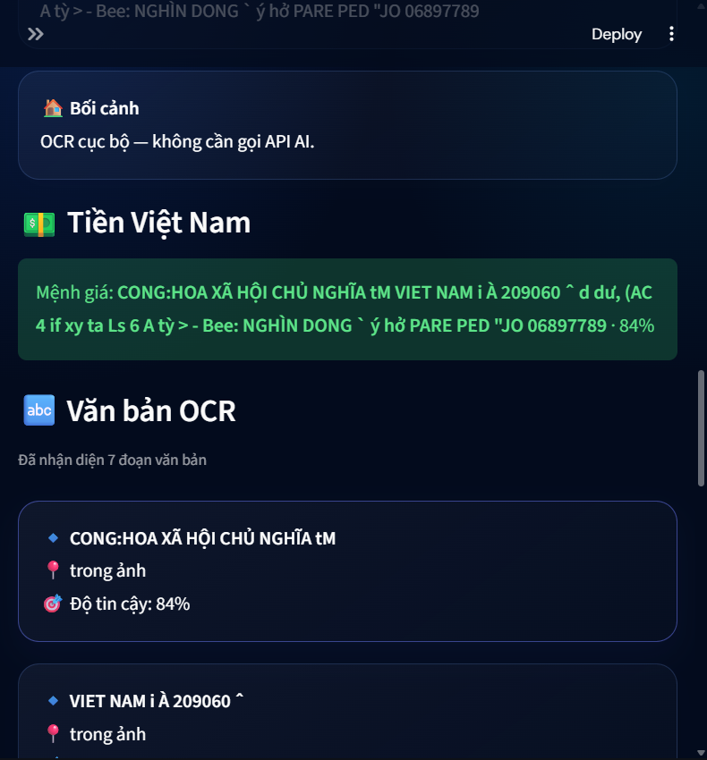
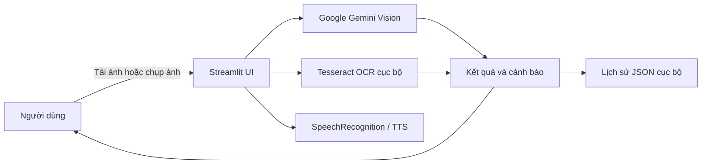

<div align="center">



# VisionAI Pro

### Trợ lý thị giác AI hỗ trợ tiếp cận thông tin hình ảnh

Ứng dụng web dùng **Google Gemini** để mô tả và trả lời câu hỏi về ảnh, kết hợp **Tesseract OCR** để đọc văn bản cục bộ. Giao diện Streamlit có hỗ trợ giọng nói, lịch sử phân tích và các tùy chọn trợ năng.

<p>
  
  
  
  
</p>

**[Mã nguồn](https://github.com/trungpham07012004/visionai-pro)** · **[Báo cáo đồ án](Báo-cáo-latex/do-an.tex)**

</div>

---

## Giới thiệu

VisionAI Pro là đồ án xây dựng trợ lý thị giác bằng tiếng Việt. Người dùng có thể tải ảnh để nhận mô tả, hỏi về nội dung ảnh hoặc đọc chữ bằng OCR. Kết quả có thể được đọc thành tiếng và lưu trong lịch sử trên máy.

## Minh họa

<div align="center">
  
  
  
</div>

*Ảnh minh họa là kết quả chạy thử trên ảnh mẫu; độ chính xác thực tế phụ thuộc ảnh, OCR và phản hồi của mô hình.*

## Chức năng chính

| Chức năng | Mô tả |
|---|---|
| Phân tích ảnh bằng Gemini | Mô tả toàn cảnh, nhận biết vật thể và vị trí tương đối |
| Hỗ trợ tiếp cận | Đọc nội dung ảnh, văn bản và gợi ý bằng tiếng Việt |
| Hỗ trợ di chuyển | Nêu vật cản/nguy cơ suy ra từ một ảnh tĩnh |
| Nhận diện tiền Việt | Phân tích ảnh tiền bằng Gemini |
| Hỏi đáp và tìm vật | Đặt câu hỏi hoặc tìm một vật trong ảnh hiện tại |
| OCR cục bộ | Đọc văn bản bằng Tesseract với dữ liệu ngôn ngữ đã cài |
| Giọng nói | Đọc kết quả bằng Edge TTS/Windows TTS; nhận dạng giọng nói cần Internet |
| Lịch sử và trợ năng | Xem lại phân tích, thống kê, tăng cỡ chữ/nút và làm rõ focus bàn phím |

## Kiến trúc



## Công nghệ

| Thành phần | Công nghệ |
|---|---|
| Giao diện | Python, Streamlit |
| Phân tích hình ảnh | Google Gemini API (`google-genai`) |
| OCR | Tesseract OCR, `pytesseract`, Pillow |
| Nhận dạng và tổng hợp giọng nói | SpeechRecognition, Edge TTS, Windows SAPI5 |
| Kiểm thử | `unittest` |

## Chạy trên Windows

### Yêu cầu

- Python 3.11 hoặc 3.12.
- Internet và Gemini API key để dùng các chức năng AI.
- Tesseract cùng dữ liệu `vie` và `eng` nếu muốn dùng OCR cục bộ.

### Cài đặt

Mở PowerShell trong thư mục dự án (thư mục chứa `app.py`), sau đó chạy:

```powershell
py -3.12 -m venv .venv
.\.venv\Scripts\Activate.ps1
python -m pip install -r requirements.txt
Copy-Item .env.example .env
notepad .env
```

Trong `.env`, điền API key lấy từ [Google AI Studio](https://aistudio.google.com/apikey):

```dotenv
GEMINI_API_KEY=YOUR_GEMINI_API_KEY
```

Lưu file rồi khởi động ứng dụng:

```powershell
python -m streamlit run app.py
```

Mở địa chỉ `http://localhost:8501` trong trình duyệt. Có thể dùng `CHAY_VISIONAI.bat` để chạy trên Windows.

> **Giữ API key riêng tư:** `.env` chỉ để trên máy cá nhân. Không commit file này, không ghi key vào README, ảnh chụp hoặc báo cáo. `.env.example` là mẫu trống, không phải API key dùng được.

## Triển khai web

Ứng dụng có thể triển khai trên Streamlit Community Cloud:

1. Đưa source lên GitHub với `app.py` và `requirements.txt` ở thư mục gốc.
2. Tạo ứng dụng tại [share.streamlit.io](https://share.streamlit.io/) và chọn repository, nhánh `main`, file `app.py`.
3. Trong **Advanced settings → Secrets**, đặt:

   ```toml
   GEMINI_API_KEY = "YOUR_GEMINI_API_KEY"
   ```

4. Deploy và mở URL `streamlit.app` được cấp.

`packages.txt` cài Tesseract tiếng Anh/Việt cho môi trường Linux. Các tính năng Gemini cần API key và Internet; STT cần dịch vụ nhận dạng qua Internet.

## Kiểm thử

Chạy bộ kiểm thử cục bộ (không gọi Gemini thật):

```powershell
python -m unittest discover -s tests -v
```

Các kiểm thử xác minh một số hành vi của ứng dụng như xử lý ảnh, lưu lịch sử, trợ năng, lệnh thoại và tạo yêu cầu Gemini. Chúng không đo độ chính xác của mô hình.

## Cấu trúc dự án

```text
.
├── app.py                    # Ứng dụng Streamlit
├── modules/                  # Gemini, OCR, giọng nói, trợ năng và tiện ích
├── ui/vision_robot/          # Giao diện robot Vision
├── assets/                   # Banner và ảnh minh họa README
├── tests/                    # Kiểm thử unittest
├── data/                     # Lịch sử cục bộ được tạo khi chạy
├── .streamlit/               # Cấu hình giao diện
├── requirements.txt          # Thư viện Python
├── packages.txt              # Gói hệ thống cho môi trường Linux
└── .env.example              # Mẫu cấu hình; không chứa key thật
```

## Giới hạn và an toàn

- Mô hình có thể mô tả hoặc nhận diện sai; cần kiểm tra lại nội dung quan trọng.
- OCR tiếng Việt phụ thuộc chất lượng ảnh và dữ liệu `vie` của Tesseract.
- Hỗ trợ di chuyển chỉ suy luận từ ảnh tĩnh, không theo dõi môi trường trực tiếp. Không dùng kết quả thay cho gậy, chó dẫn đường hoặc thiết bị an toàn đã được kiểm chứng.
- Camera và microphone cần người dùng chủ động cấp quyền; chưa có đánh giá với người dùng thực tế.
- Lịch sử được lưu cục bộ trong `data/history.json`; tránh đưa thông tin nhạy cảm vào ảnh hoặc câu hỏi.
